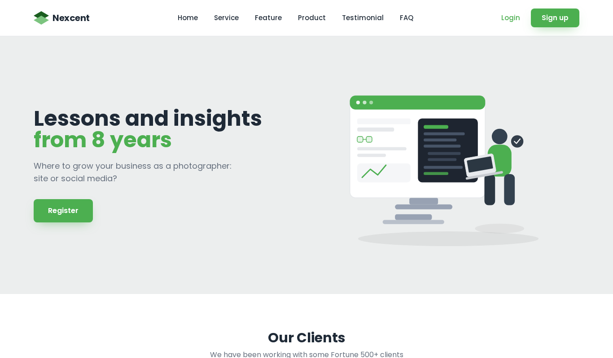

# Nexcent — Figma to Tailwind CSS

Community-platform landing page converted from a Figma design to Tailwind CSS.

**Live demo:** https://ammad-codes.github.io/FIGMA-to-tailwind-CSS/

## Tech used
HTML5, Tailwind CSS

## Features
- Pixel-faithful Figma conversion
- Hero, clients, features and testimonial sections
- Responsive utility-first styling

## Author
Ammad Khan — Frontend Developer (HTML, CSS, Tailwind) · https://github.com/ammad-codes
